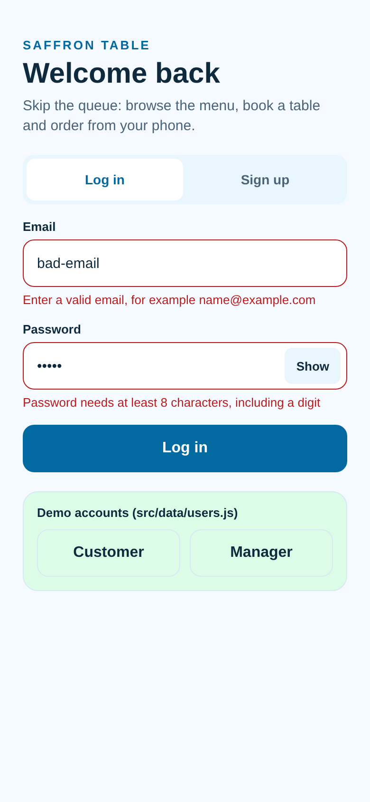
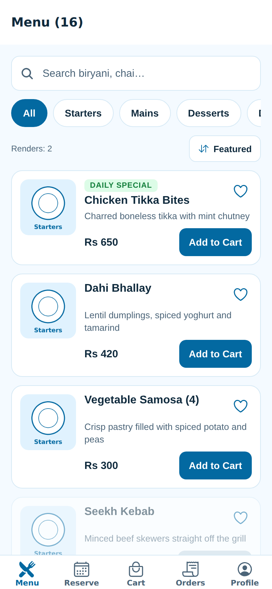
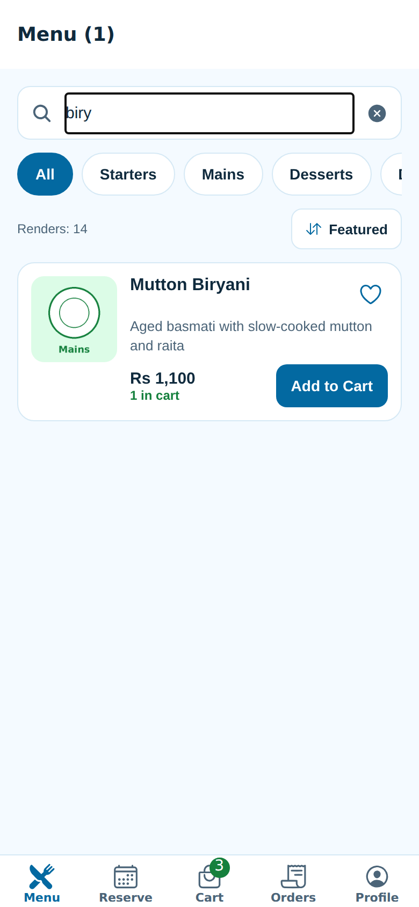
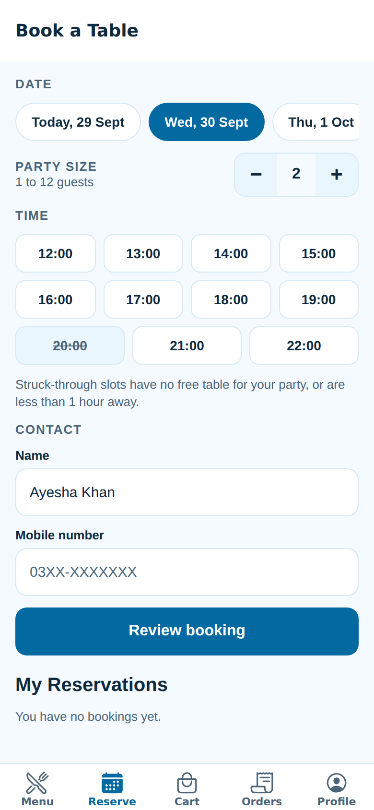
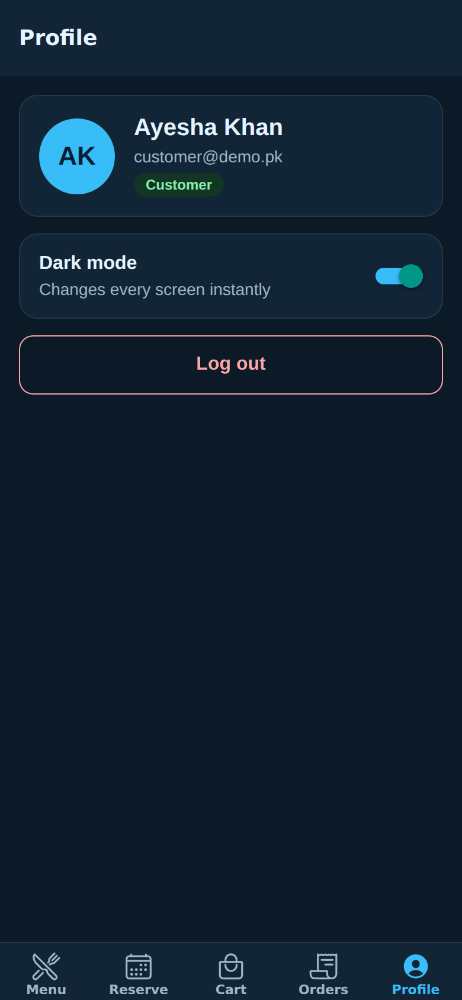
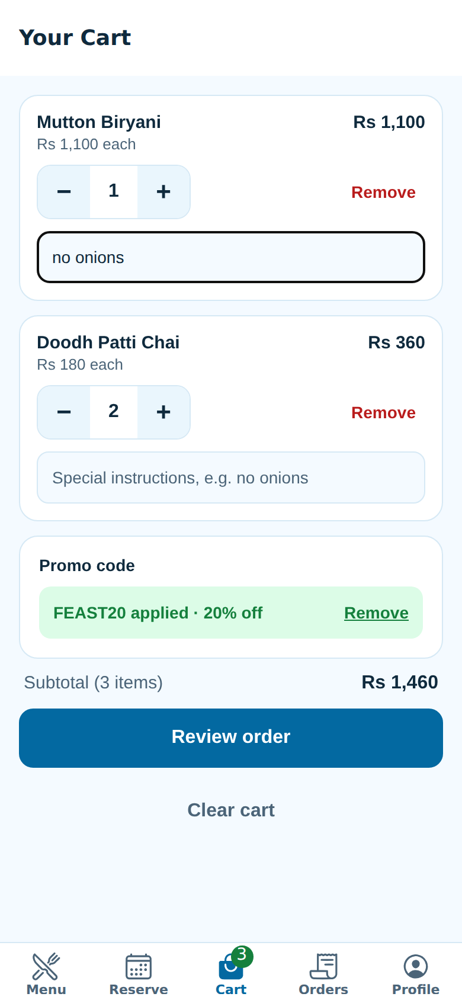
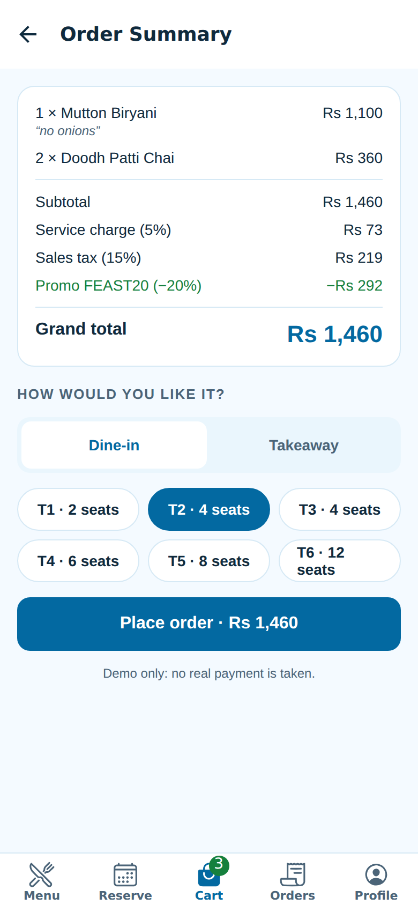
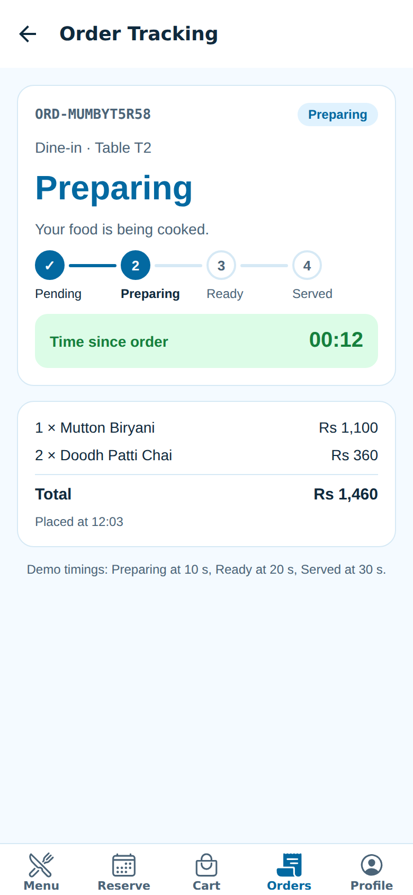

# Restaurant App MVP — "Saffron Table"

A frontend-only React Native (Expo) prototype for **Assignment 1, Fall 2026**. Customers browse the menu, book tables, order ahead and track their order. Managers handle orders, reservations and the menu.
No backend, no external API, no state-management library. All data is mock data held in React state and saved on the device with AsyncStorage.

Theme colours: **sky blue, white and light green** (light and dark mode).

| | |
|---|---|
| SRS | [`A1/SRS.pdf`](A1/SRS.pdf) |
| UML | [`A1/UML/`](A1/UML) (use case, class, sequence, state machine, component) |
| Demo video | **[add your screen-recording link here, max 3 minutes]** |

---

## 1. Installation and running

**Requirements**
- Node.js **20 LTS or 22 LTS** (tested with Node 22.22) and npm 10+
- The **Expo Go** app on your phone (Android / iOS), or an Android emulator / iOS simulator
- Expo SDK **57** (installed by `npm install`)

```bash
git clone https://github.com/<your-username>/restaurant-app-mvp.git
cd restaurant-app-mvp
npm install
npx expo start
```

Then:
- **Phone (Expo Go):** scan the QR code in the terminal (Android: Expo Go app; iOS: Camera app). Phone and computer must be on the same Wi-Fi.
- **Android emulator:** start an emulator in Android Studio, then press `a` in the Expo terminal (or run `npm run android`).
- **iOS simulator (macOS):** press `i` (or run `npm run ios`).
- **Web (quick demo):** press `w` (or run `npm run web`).

**Tests:** `npm test` runs the Jest tests for `cartReducer` (12 cases).

To reset saved data, clear the Expo Go app's storage, or reinstall it.

## 2. Mock login credentials

| Role | Email | Password |
|---|---|---|
| Customer | `customer@demo.pk` | `customer1` |
| Manager | `manager@demo.pk` | `manager1` |

Promo codes: `WELCOME10` (10% off), `FEAST20` (20% off).
The login screen also has **Customer / Manager** buttons that fill these in for you.

## 3. Folder structure

```
restaurant-app-mvp/
├── App.js                      # wraps the app in all providers
├── A1/
│   ├── SRS.pdf
│   ├── UML/                    # 5 diagrams (PNG) + sources in UML/src
│   └── srs-source/             # HTML source of the SRS
├── __tests__/cartReducer.test.js
├── assets/menu/                # local food-category images (offline)
├── screenshots/
└── src/
    ├── components/             # MenuItemCard (React.memo), CartItemRow, PrimaryButton, FormField, Chip, …
    ├── screens/                # Login, Menu, Cart, OrderSummary, OrderTracking, MyOrders, Reservation, Profile, ManagerDashboard
    ├── context/                # AuthContext, ThemeContext, CartContext, OrdersContext, MenuContext, ReservationsContext
    ├── reducers/               # cartReducer, ordersReducer, menuReducer, reservationsReducer
    ├── hooks/                  # useForm, useDebounce, useReservation, usePersistedReducer
    ├── data/                   # users, categories, menu, tables, reservations, promoCodes
    ├── navigation/             # AppNavigator (root stack + bottom tabs + nested stacks), navigationRef
    ├── theme/colors.js         # light + dark palettes
    ├── constants/              # pricing rates, order statuses + allowed transitions
    └── utils/                  # formatting, validation, dates, pricing, confirm dialogs
```

## 4. Hooks used on each screen

| Screen / module | useState | useEffect | useRef | useContext | useReducer | useMemo | useCallback | Custom hooks |
|---|:-:|:-:|:-:|:-:|:-:|:-:|:-:|---|
| LoginScreen (Q3, Q6, Q9) | ✓ | ✓ | ✓ | ✓ | | | ✓ | `useForm`, `useAuth` |
| MenuScreen (Q4, Q5, Q8) | ✓ | ✓ | ✓ | ✓ | | ✓ | ✓ | `useDebounce`, `useMenu`, `useCart` |
| ProfileScreen (Q6) | | | | ✓ | | | | `useAuth`, `useTheme` |
| CartScreen (Q7) | ✓ | | | ✓ | ✓ (CartProvider) | | ✓ | `useCart` |
| OrderSummaryScreen (Q8, Q10) | ✓ | | | ✓ | | ✓ | | `useCart`, `useOrders` |
| ReservationScreen (Q9) | ✓ | | | ✓ | ✓ (provider) | ✓ (in hook) | ✓ (in hook) | `useReservation` |
| OrderTrackingScreen (Q10) | ✓ | ✓ | | ✓ | ✓ (OrdersProvider) | | | `useOrders` |
| MyOrdersScreen (Q10) | | | | ✓ | | ✓ | | `useOrders`, `useAuth` |
| ManagerDashboardScreen (Q10) | ✓ | | | ✓ | ✓ (providers) | ✓ | ✓ | `useForm` |
| MenuItemCard (Q8) | | | | ✓ | | | | wrapped in `React.memo` |
| Context providers | ✓ | ✓ | | | ✓ | ✓ | ✓ | `usePersistedReducer` |

## 5. Screenshots

Taken from the web build. Replace them with screenshots from your phone if your instructor wants device screenshots.

| Q3 validation errors | Q3 successful login | Q5 render counter | Q9 disabled slot |
|---|---|---|---|
|  |  |  |  |

| Q6 dark profile | Q7 cart + promo | Q8 order summary | Q10 tracking |
|---|---|---|---|
|  |  |  |  |

**Q8 console screenshots (take these yourself):** open the menu, open the Metro terminal or browser console, and tap one heart. With the optimisation, only one `[render] MenuItemCard: <name>` line is printed. For the "before" screenshot, temporarily export `MenuItemCard` without `memo(...)` in `src/components/MenuItemCard.js`. Every visible card then logs.

## 6. Demo video

Screen recording (max 3 minutes) of the full flow: **[paste link here]**

Flow tested:
1. Sign up as a customer.
2. Browse and search.
3. Add items and apply a promo code.
4. Reserve a table.
5. Place an order and watch it progress.
6. Log out and log in as the manager, then update the same order.

---

## 7. Written answers

### Q4 — What happens if the filtering effect's dependency array is empty?
With `[]`, the filtering effect runs only once, right after the first render. At that moment `menuItems` is still the empty array (the 1.5-second "fetch" hasn't finished), so `filteredItems` is set to `[]` and never updated again. The menu would stay blank even after the data loads. Tapping a category chip would change `selectedCategory`, but the effect wouldn't re-run, so the list wouldn't change either. The dependency array tells React *when* to re-synchronise. Listing `selectedCategory` and `menuItems` makes the effect run after every change to either value, so the filtered list always matches the current data and chosen category. ESLint's `react-hooks/exhaustive-deps` rule warns about exactly this bug.

### Q6 — Why context instead of prop drilling?
The logged-in user and the theme are needed by almost every screen, and those screens sit several levels deep inside nested stacks and tabs. Prop drilling would force every navigator and intermediate component to accept and forward `user` and `colors` props it never uses. Context lets any screen read them directly with `useAuth()` or `useTheme()`, and switching the theme updates the whole app at once. The custom hooks also throw a clear error if a screen is rendered outside its provider.
**Drawback:** every component that consumes a context re-renders whenever the context value changes. Toggling dark mode re-renders all themed components, even memoised ones. That's why the context value is wrapped in `useMemo` and the data is split into several small contexts instead of one big one.

### Q7 — Cart reducer test cases

| # | Action | Initial state | Expected state |
|---|---|---|---|
| 1 | `ADD_ITEM` Biryani | `items: []` | `[Biryani ×1]` |
| 2 | `ADD_ITEM` Biryani | `[Biryani ×1]` | `[Biryani ×2]` |
| 3 | `ADD_ITEM` Seekh Kebab (unavailable) | `items: []` | unchanged (same object) |
| 4 | `INCREMENT` Chai | `[Chai ×2]` | `[Chai ×3]` |
| 5 | `DECREMENT` Chai | `[Chai ×1, Biryani ×2]` | `[Biryani ×2]` (Chai removed at 0) |
| 6 | `REMOVE_ITEM` Chai | `[Chai ×5]` | `[]` |
| 7 | `UPDATE_NOTE` Biryani "no onions" | `[Biryani note: ""]` | `[Biryani note: "no onions"]` |
| 8 | `APPLY_PROMO` "feast20" | `promoCode: null, 0%` | `promoCode: "FEAST20", 20%` |
| 9 | `APPLY_PROMO` "FREEFOOD" | `promoCode: null` | unchanged (invalid code rejected) |
| 10 | `REMOVE_PROMO` | `WELCOME10, 10%` | `promoCode: null, 0%` |
| 11 | `CLEAR_CART` | 2 items + WELCOME10 | `initialCartState` |
| 12 | `INCREMENT` / `UPDATE_NOTE` | any state | the previous state object is never mutated |

All 12 cases are automated in `__tests__/cartReducer.test.js` (bonus): run `npm test`.

**useReducer vs useState for the cart:** the cart has several related pieces of state (items, quantities, notes, promo code, discount) and eight different ways to change them. With `useState`, that logic would be spread across many setter calls in different screens and would be easy to get out of sync. `useReducer` keeps every transition in one pure function that is easy to read and unit-test, and screens just `dispatch` a named action. `useState` would have been enough for a simple list of item ids with no quantities, notes or promo codes, or for a single screen that owns all the logic.

### Q8 — When NOT to use useMemo and useCallback
Don't use them by default. Each call costs memory and a dependency comparison on every render, and makes code harder to read. Skip `useMemo` for cheap calculations (adding two numbers, filtering a 10-item array) and for values that change on nearly every render anyway. Skip `useCallback` when the function is passed only to native elements such as `<Pressable>` or `<TextInput>`, or to children that are not wrapped in `React.memo`. A stable reference gains nothing there. Both are also pointless if the dependency list changes every render. Use them when you have measured a real problem: an expensive derived list (like the menu filter + search + sort), or a handler passed to a memoised child in a long `FlatList` (like `MenuItemCard`). Optimise after profiling, not before.

---

## 8. Suggested commit plan (one or more commits per question)

1. `Q1: add SRS` → `A1/SRS.pdf`
2. `Q2: add UML diagrams` → `A1/UML/*`
3. `Q3: login and signup screen with useState validation` → `LoginScreen.js`, `src/data/users.js`
4. `Q4: menu screen with useEffect loading, filter, refresh` → `MenuScreen.js`, `src/data/menu.js`
5. `Q5: search, debounce, back-to-top, render counter with useRef`
6. `Q6: AuthContext, ThemeContext, profile and dark mode`
7. `Q7: cartReducer, CartContext, cart screen, tests`
8. `Q8: order summary with useMemo, memoised MenuItemCard, sort`
9. `Q9: useForm, useDebounce, useReservation, reservation screen`
10. `Q10: orders context, tracking timers, manager dashboard, AsyncStorage`
